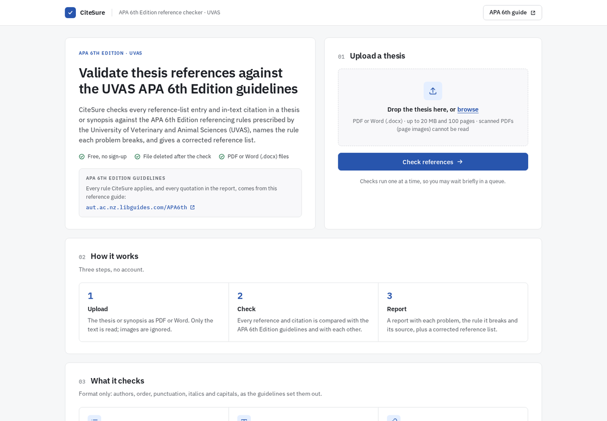
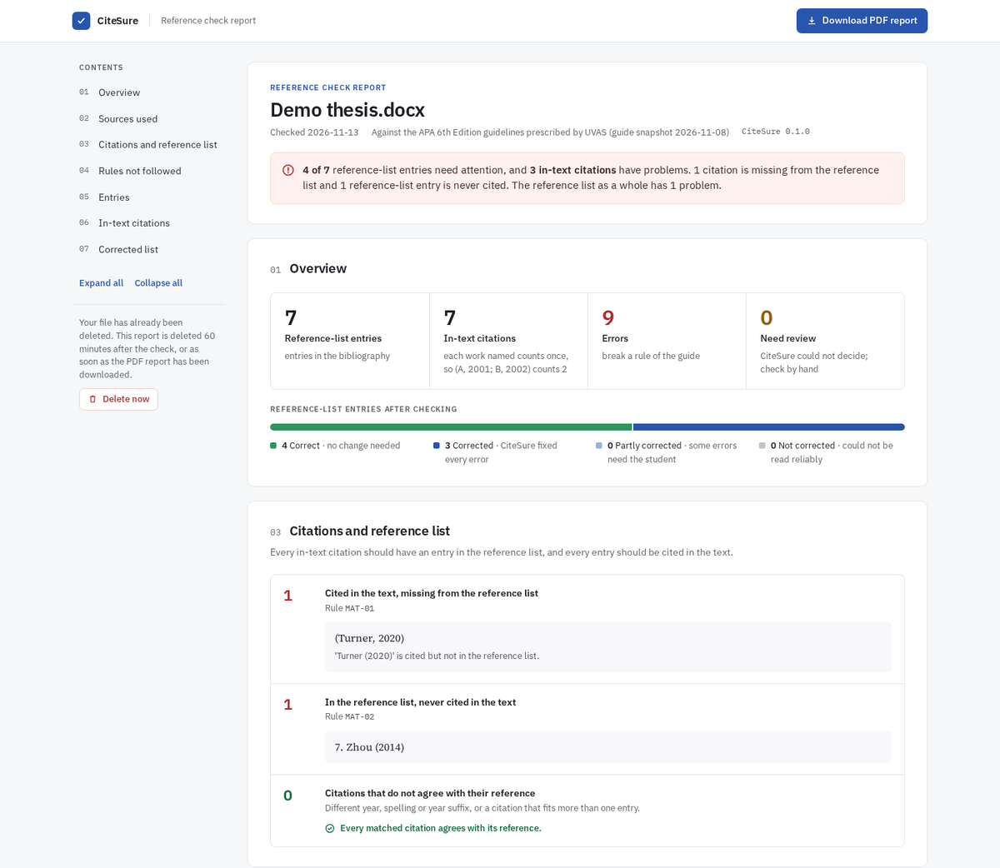
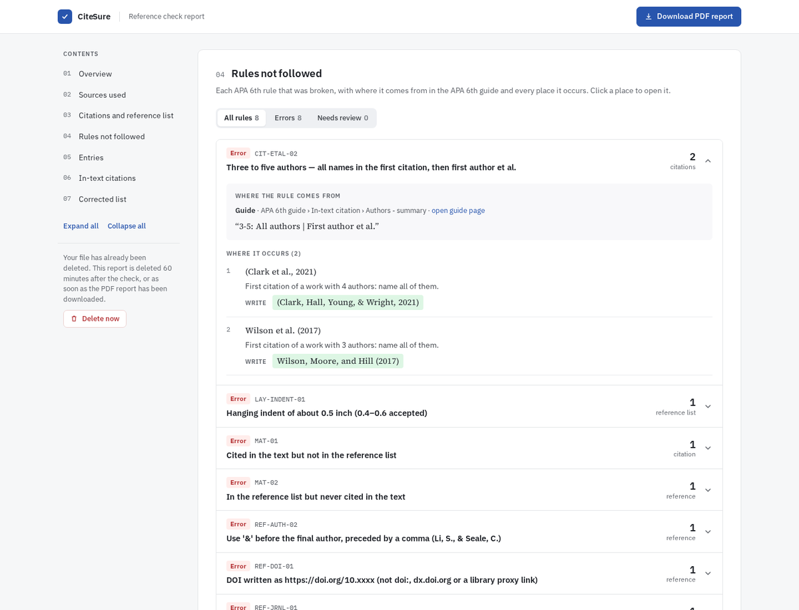

<p align="center">
  <a href="https://citesure.duckdns.org"></a>
</p>

<p align="center">
  <a href="https://citesure.duckdns.org"></a>
  
  
  
  
</p>

<h3 align="center">
  Upload a thesis or synopsis → get every reference and in-text citation checked,<br>
  each problem explained with the rule it breaks, and a corrected reference list.
</h3>

<p align="center"><b>🌐 Try it: <a href="https://citesure.duckdns.org">citesure.duckdns.org</a></b> · free · no sign-up · your file is deleted after the check</p>

---

## ✨ What is CiteSure?

**CiteSure** checks the references of a thesis or synopsis against the **APA 6th Edition guidelines
prescribed by UVAS** (University of Veterinary and Animal Sciences). It reads a PDF or Word file,
finds the reference list, checks every entry and every in-text citation, checks that the two
agree, and writes a clear report:

- **What is wrong**, entry by entry, in plain words
- **Which rule** it breaks, with the guide's own words and a link to the guide page
- **How to write it**, with a fully corrected, alphabetical reference list

Every rule comes from the APA 6th Edition reference guide
([aut.ac.nz.libguides.com/APA6th](https://aut.ac.nz.libguides.com/APA6th)), written down in a
78-rule [rulebook](rulebook/RULEBOOK.md). CiteSure checks the **format** only; it does not check
that a source exists or that its details are true.

<p align="center"></p>

## 🔍 What it checks

| | Area | Examples |
|---|---|---|
| 📚 | **Reference list** | each entry against its source type's template: authors, year, title, journal, volume, issue, pages, publisher |
| 🔤 | **Italics and capitals** | journal name and volume in italics, sentence case for titles, headline style for journal names |
| 🔗 | **DOIs and URLs** | `https://doi.org/…` format, no `doi:` or library proxy links, journal homepages instead of article links |
| ❝ | **In-text citations** | `&` or `and`, *et al.*, commas, several works in one bracket, page numbers for quotes |
| ↔️ | **Citations ↔ references** | cited but not listed, listed but never cited, years and spellings that differ |
| 🗂️ | **The list as a whole** | heading, alphabetical order, duplicates, merged entries, other citation styles (e.g. Vancouver) |

Two levels: **Error** breaks a rule of the guide; **Needs review** means CiteSure could not decide,
so a person should look.

## 🖼️ Screenshots

<table>
  <tr>
    <td width="50%"><p align="center"><sub><b>Home</b>: drop a PDF or Word file</sub></p></td>
    <td width="50%"><p align="center"><sub><b>Report</b>: overview and citation consistency</sub></p></td>
  </tr>
  <tr>
    <td colspan="2"><p align="center"><sub><b>Rules not followed</b>: each rule once, its source in the guide, and every place it occurs</sub></p></td>
  </tr>
</table>

<sub>Screenshots use an invented demo thesis.</sub>

## 📄 The report

1. **Overview**: entries, in-text citations, errors and items to review
2. **Sources used**: how many books, journal articles, web pages… by type
3. **Citations and reference list**: missing entries, uncited entries, mismatched years and spellings
4. **Rules not followed**: each broken rule with its source and every place it occurs
5. **Entry by entry**: as written (changes struck through), the problems, the corrected entry
6. **In-text citations**: each citation with a problem and how to write it
7. **Corrected reference list**: alphabetical, ready to paste

Read it on screen (filters, search, links between sections) or download it as a PDF.

## 🔒 Privacy

- The uploaded file is **deleted as soon as the check ends**.
- The report is deleted once the PDF is downloaded, on **Delete now**, or after 60 minutes.
- No accounts, no tracking, no third-party fonts or scripts; logs hold only job IDs and timings.
- Checks run one at a time in a separate, time- and memory-limited process; uploads are
  rate-limited and checked for size, type and page count.

## 🛠️ Tech stack

| Part | Built with |
|---|---|
| Engine | Python 3.12 · pdfplumber · python-docx · pydantic · a YAML rulebook |
| Web app | FastAPI · Jinja2 · plain HTML, CSS and JavaScript |
| Reports | WeasyPrint (PDF) · IBM Plex Sans/Mono and Source Serif 4 (bundled, OFL) |
| Hosting | Oracle Cloud Always Free VM · Caddy (automatic HTTPS) · systemd · DuckDNS |

## 🚀 Run it locally

Needs [uv](https://docs.astral.sh/uv/) and, for PDF reports, the Pango library
(`apt install libpango-1.0-0 libpangoft2-1.0-0`).

```bash
git clone https://github.com/Taha493/CheckRef.git
cd CheckRef
uv sync

# the web app on http://127.0.0.1:8000
uv run checkref serve

# or check one file from the command line (JSON on screen, report files in ./out)
uv run checkref check thesis.pdf --report out
```

Web-app settings (upload size, page limit, queue, rate limit, expiry, bot check) are environment
variables; see [`deploy/checkref.env.example`](deploy/checkref.env.example).

## ☁️ Deployment

The live site runs on one small Oracle Cloud VM behind Caddy. The scripts in [`deploy/`](deploy/)
set it up from scratch: [`oracle-setup.md`](deploy/oracle-setup.md) explains the steps,
`deploy.sh` copies the code and runs `setup_server.sh`, which installs Caddy, uv and the
`citesure` systemd service with its hardening.

## 🗺️ Project layout

```text
src/checkref/
  ingest/        read PDF and Word files, keeping italics
  normalize/     page numbers, headers and footers, look-alike characters, line joining
  segment/       find the reference list and split it into entries
  classify/      decide each entry's source type (journal article, book, web page…)
  llm/           optional local language model for hard entries (off on the live site)
  parse/         read authors, year, title, journal, DOI… from each entry
  rules/         the rulebook loader and the reference checks
  citations/     find in-text citations, check them, match them to the list
  correct/       build the corrected entries and the corrected list
  report/        the report (HTML on screen, PDF) and its bundled fonts
  web/           the FastAPI app, job queue and worker process
rulebook/        rules.yaml · templates.yaml · settings.yaml · RULEBOOK.md (readable version)
data/            journal-name list and the guide snapshot's manifest
deploy/          server setup, Caddy, systemd, DuckDNS
tools/           guide snapshot, journal index and rulebook report builders
```

## 👥 Credits

<p>
  <b>Owned by</b> Dr. Muhammad Akmal, University of Veterinary and Animal Sciences (UVAS)<br>
  <b>Developed by</b> <a href="https://github.com/Taha493">Taha Mahmood</a>
</p>

<p align="center"><sub>CiteSure checks reference <i>format</i> against the APA 6th Edition guidelines. It does not check that sources exist or that their details are true.</sub></p>
